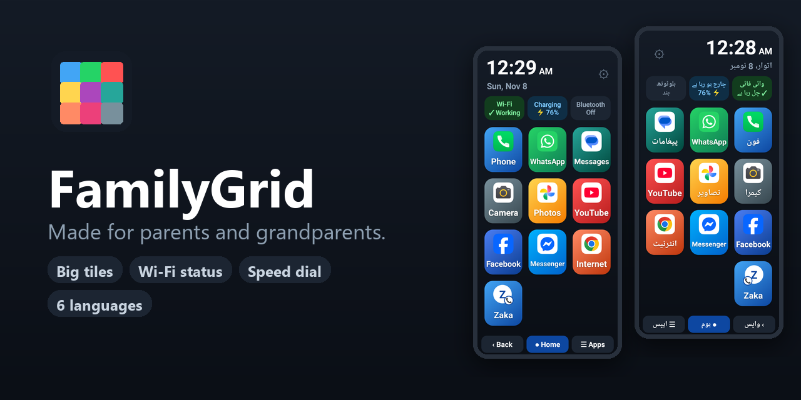
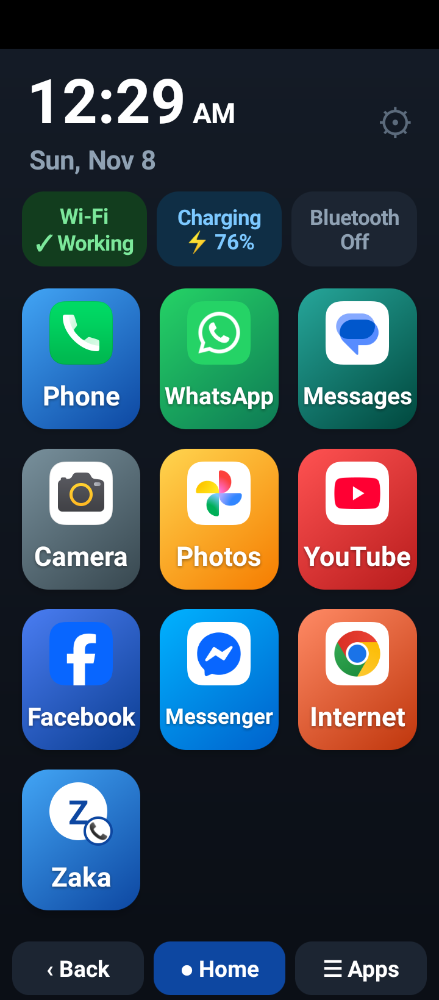
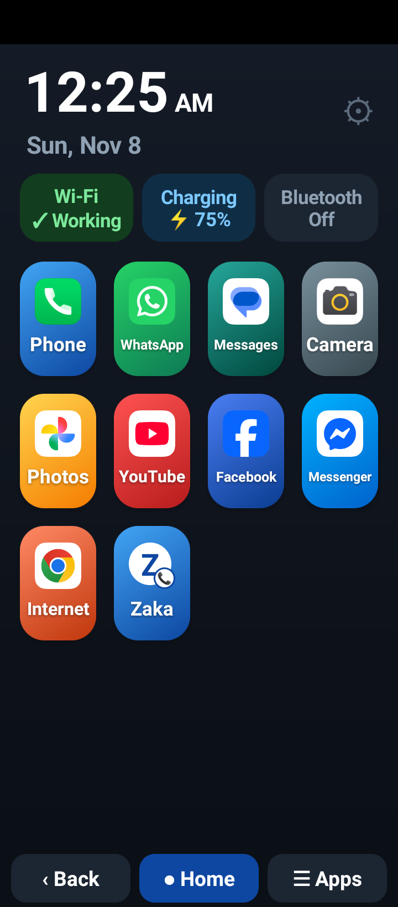
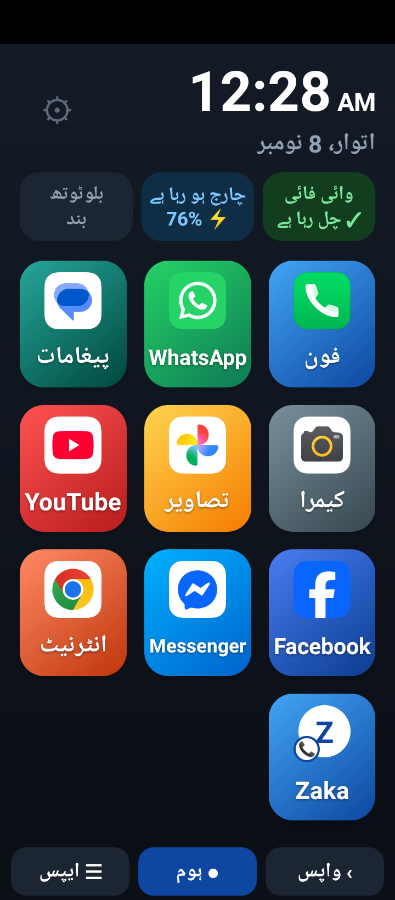
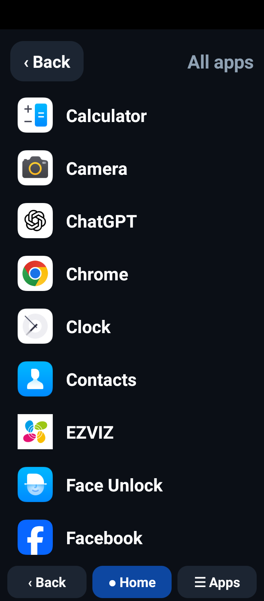
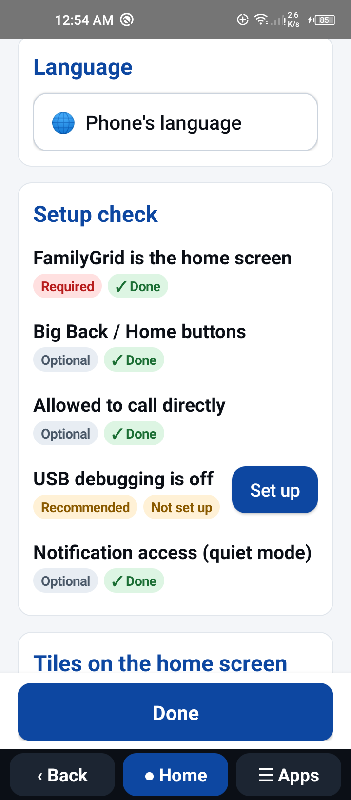
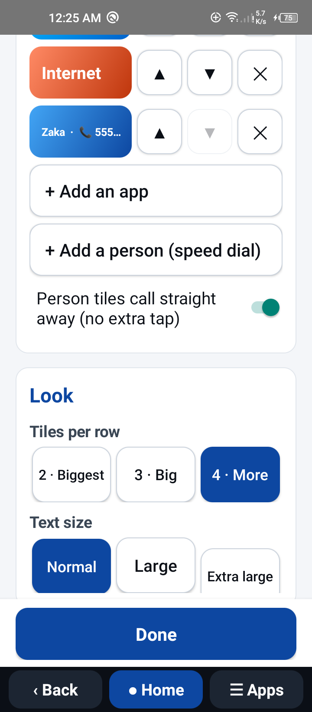
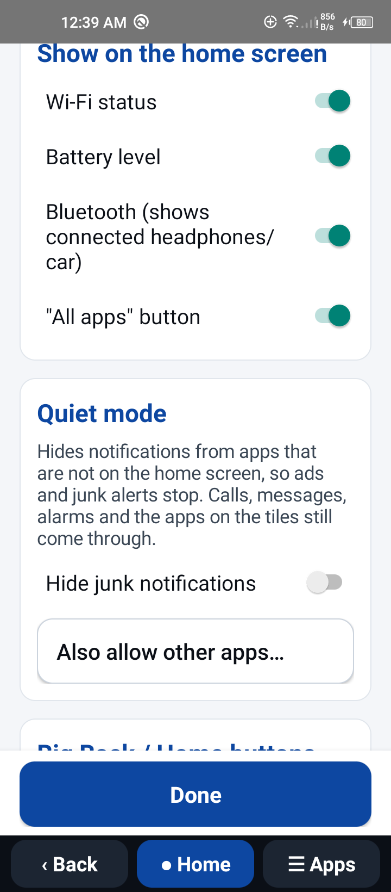

<p align="center">
  <b>⭐ If FamilyGrid helps your family, please <a href="https://github.com/zaddy88/familygrid-launcher">star this repo</a>. It helps other families find it! ⭐</b>
</p>

<p align="center">
  <a href="https://github.com/zaddy88/familygrid-launcher/releases/latest/download/FamilyGrid.apk"><b>📥 Download FamilyGrid.apk (direct link)</b></a> · Android 7.0+ · free, no ads<br>
  <sub>Blocked by Play Protect? See <a href="#-app-blocked-to-protect-your-device">how to install</a>.</sub>
</p>

<p align="center">
  
</p>

<p align="center">
  <a href="https://github.com/zaddy88/familygrid-launcher/releases/latest/download/FamilyGrid.apk"></a>
  
  
  
  <a href="https://whop.com/checkout/plan_Xy4vheVKTXtxv"></a>
</p>

# FamilyGrid Launcher

**FamilyGrid turns any Android phone into a calm, simple home screen for the people who find phones confusing.**
Big colourful tiles for the few apps and people that matter, a Wi-Fi status you can actually trust,
and large labelled **Back / Home / Apps** buttons. No ads, no tracking, no account.

> Set it up for a loved one in two minutes, then press Home and choose FamilyGrid.

---

## ✨ Features at a glance

| | |
|---|---|
| 🟦 **Big, clear tiles** | 2, 3 or 4 per row, three text sizes, and it scrolls when you add more |
| 📞 **Speed-dial people** | One tap calls family (or opens the keypad with the number ready) |
| 📶 **Honest Wi-Fi status** | "Working", "No internet" or "Off", checked for real internet, not just a connection |
| 🔋 **Battery & Bluetooth** | Charging state, a "Charge me!" warning, and the connected headset or car |
| ⬅️ **Big Back / Home / Apps** | Large labelled buttons over the small system icons, in every app |
| 🌍 **6 languages** | English, اردو, العربية, हिन्दी, বাংলা, Español, with right-to-left layouts |
| 🧭 **Guided setup** | First-run setup from the apps on *this* phone, plus a checklist of what's done |
| 🔕 **Quiet mode** | Hides junk notifications from apps that aren't on the home screen |
| 🤖 **AI clean-up guide** | Step-by-step prompts to remove bloatware and pop-ups with any AI coding agent |
| 🔒 **PIN lock** | So tiles aren't changed by accident |
| 🛡️ **Private** | Collects and sends nothing. See the [privacy policy](docs/PRIVACY.md) |

---

## 📱 Screenshots & features

<table>
<tr>
<td width="33%" align="center"><br><b>Home screen</b></td>
<td width="33%" align="center"><br><b>4 tiles per row</b></td>
<td width="33%" align="center"><br><b>Urdu (right-to-left)</b></td>
</tr>
</table>

### 🏠 The home screen
- **Big tiles with real app icons.** Long names shrink to fit instead of being cut off.
- **Generic defaults that work on any brand:** Phone, WhatsApp, **Messages**, **Camera**, **Photos** and
  **Internet** are matched to whatever apps *this* phone uses, plus YouTube, Facebook and Messenger if installed.
  Apps that aren't installed are simply left out.
- **Person tiles (speed dial)** show the person's initial with a small 📞 badge, so it's clear a tap means *call*.
- **Clock and date** in large type, 12- or 24-hour to match the phone, with AM/PM.
- **Status chips** (each can be switched off):
  - **Wi-Fi:** ✓ Working / ! No internet / ✕ Off. Tap to open Wi-Fi settings.
  - **Battery:** level, ⚡ charging, and a red **"Charge me!"** under 15 %.
  - **Bluetooth:** shows the connected headset, speaker or car by name.
- **Many tiles? It scrolls.** Rows keep a comfortable size; extra rows scroll instead of shrinking.
- Back on the home screen does nothing, so nothing surprising happens.

<table>
<tr>
<td width="33%" align="center"><br><b>All apps</b></td>
<td width="33%" align="center"><br><b>Settings: setup check</b></td>
<td width="33%" align="center"><br><b>Tiles, speed dial & look</b></td>
</tr>
</table>

### 🔕 Quiet mode (stop junk notifications)


Switch on **Hide junk notifications** and FamilyGrid hides notifications from any app that isn't on the
home screen: ads, "cleaner" alerts, game offers. **Calls, missed calls, messages, alarms**, Android itself
and every app on a tile still come through. Use **Also allow other apps…** for anything else
(a banking app, for example).

It only checks *which app* sent a notification; the text is never read, stored or shared. Android asks
you to grant notification access, and FamilyGrid explains what it does first.

> Pop-ups that draw **over** other apps and preinstalled bloatware can't be removed by any normal app.
> For those, see the [AI agent clean-up guide](#-clean-up-a-phone-with-an-ai-agent) below.

<br clear="right">

### ⬅️ Big Back / Home / Apps buttons
An optional bar sits **exactly over Android's small navigation icons** in every app, so it never covers
the app itself. The labels can be renamed in any language (for example "واپس", "Wapas"). It only draws
buttons; it **cannot read the screen** (`canRetrieveWindowContent="false"`). Android asks you to switch
it on yourself, and FamilyGrid explains what it does first.

### 📋 All apps
Every installed app in a big, plain list with a clearly labelled **‹ Back** button.

### ⚙️ Easy settings
Open settings in any of three ways. A PIN, if you set one, protects all of them.
- the **FamilyGrid Settings** icon in the phone's app drawer (works right after install),
- **hold the ⚙** next to the date (a quick tap only shows a hint),
- **hold the clock** for 2 seconds.

Inside, everything is grouped in clear cards with a **Done** button that stays at the bottom:
- **Setup check:** each item is marked **Required** or **Optional** and shows **✓ Done** or **Not set up**.
  Tapping **Set up** first explains *exactly what to tap* ("choose FamilyGrid Launcher → Always",
  "tap Allow"…), then opens that Android screen: default home app, big buttons, call permission,
  notification access for Quiet mode, and Bluetooth on Android 12+.
- **Tiles:** add apps or people (from contacts or typed in), reorder with ▲ ▼, rename, recolour, remove.
  Right under *Add a person* is the switch for **calling straight away** without an extra tap.
- **Look:** 2 · 3 · 4 tiles per row, and Normal / Large / Extra large text.
- **Show on home screen:** Wi-Fi, battery, Bluetooth and the "All apps" button, each on or off.
- **Language** (in the app only; the phone's language stays as it is), **PIN lock**, and **Reset**.

### 🌍 Languages
English · اردو (Urdu) · العربية (Arabic) · हिन्दी (Hindi) · বাংলা (Bengali) · Español.
Urdu and Arabic switch the whole layout to right-to-left. Built-in tile names ("Phone", "Camera")
follow the language; names the family typed are kept.

---

## 🤖 Clean up a phone with an AI agent

Bloatware, full-screen pop-ups and junk notifications are the other half of the problem. The
**[AI agent clean-up guide](docs/AI_AGENT_GUIDE.md)** gives you **8 copy-paste prompts** that walk any AI
coding agent (Claude Code, OpenAI Codex, Cursor, Gemini CLI, Warp…) through it over USB with ADB:

1. Connect and inventory the phone (read-only)
2. Sort apps into keep / remove, and **wait for your approval**
3. Disable junk first, as a trial run
4. Remove it for good (still reversible)
5. Stop apps that pop up over other apps
6. Quiet the notifications
7. Install FamilyGrid
8. Check that everything still works

No root needed, and every step comes with an undo script. Two more prompts cover **re-checking after a
system update** and **handing the phone back safely** (revoke ADB, switch off USB debugging). *I did mine with **Warp + GLM**: about 50 junk apps
gone from a TECNO POVA in one session.*

### 🛡️ Safety: how packages are chosen, and how you hand the phone back
- **Not by name guessing.** The agent cross-checks every package against the community-maintained
  [Universal Android Debloater (UAD-ng)](https://github.com/Universal-Debloater-Alliance/universal-android-debloater-next-generation)
  list and its safety ratings. Only "Recommended" ones are suggested; anything unknown goes to
  *ask me*, and **you approve every package** before anything changes.
- **Always reversible.** It disables first, removes for the current user only, and keeps a `restore-all` script plus a
  `removed-packages.txt` list.
- **After a system update**, a prompt compares against that list and shows only what came back.
- **Lock it down at handover.** ADB gives a computer far more control than any app. The handover prompt
  revokes the computer's authorisation and switches off USB debugging and Developer options. FamilyGrid's
  Setup check keeps showing **"USB debugging is off" (Recommended)** until it's done.

---

## ❓ FAQ

**Will a system update undo the clean-up?** It can: updates sometimes reinstall or re-enable removed
apps. Your FamilyGrid tiles and settings are kept. Run *Prompt 9* from the guide after an update to see
exactly what came back.

**What if I add more tiles than fit?** The home screen scrolls; tiles keep their size.

**Can FamilyGrid block pop-up ads by itself?** It hides junk *notifications* (Quiet mode). Pop-ups drawn
*over* other apps need the ADB step in the guide, because no normal app can block them.

**Is it safe to leave USB debugging on?** No. Switch it off when you're done. The Setup check reminds you.

---

## 📥 Download & install

1. **Pause Play Protect** (see why below): open the **Play Store** → tap your **profile picture** →
   **Play Protect** → **⚙ gear** → turn off **Scan apps with Play Protect**.
2. **Download** on the phone: **[FamilyGrid.apk](https://github.com/zaddy88/familygrid-launcher/releases/latest/download/FamilyGrid.apk)**
   (always the latest version), or pick one from the [releases page](https://github.com/zaddy88/familygrid-launcher/releases).
3. **Install:** tap the downloaded file. If asked, allow **Install unknown apps** for your browser, then tap **Install**.
4. **Turn Play Protect back on** (same place as step 1). FamilyGrid stays installed.
5. Press **Home** and choose **FamilyGrid Launcher → Always**.
6. Open **FamilyGrid Settings** from the app drawer and follow the setup check.

### ⚠️ "App blocked to protect your device"?

Google **Play Protect** blocks apps installed from outside the Play Store if they can use
*Accessibility* or *Notification access*. FamilyGrid uses them only for the optional big buttons and
Quiet mode, and they stay **off** until you switch them on. You can get past the block in any of these ways:

- On the warning, tap **More details → Install anyway** (some countries don't show this button), **or**
- pause Play Protect as in step 1 above, install, then switch it back on, **or**
- install from a computer with USB debugging: `adb install FamilyGrid.apk` (no warning).

### 🔒 "Restricted setting" (Android 13 and newer)

If the switch for **FamilyGrid big buttons** or **Quiet mode** is greyed out with *Restricted setting*:

1. Go to **Settings → Apps → FamilyGrid**.
2. Tap the **⋮ menu** (top right) → **Allow restricted settings**, and confirm with your PIN or fingerprint.
3. Go back and switch the service on.

> On some phones the ⋮ menu only appears after you've tried once to switch the service on.
> Installing from Google Play (coming soon) avoids both of these warnings.

### Supported Android versions

| | |
|---|---|
| **Minimum** | Android **7.0** (Nougat, API 24) |
| **Built for** | Android **16** (API 36) |
| **Tested on** | TECNO POVA (Android 10, HiOS 7) · OnePlus 10 Pro and OnePlus 8T (OxygenOS, including Android 16) |
| Shrinking long names | Android 8.0+ (on 7.x long names are shortened with "…") |
| Bluetooth device names | All versions; Android 12+ asks for the *Nearby devices* permission |
| Quiet mode | All versions (needs *notification access*) |

> **Note:** release APKs are currently signed with a development key. A future Google Play version will use
> a different key, so you'll need to uninstall the GitHub version before installing the Play one.

---

## ☕ Support FamilyGrid

FamilyGrid is free, open source, and has no ads or tracking, and it never will.
I built it so my own parents could use their phone without calling me for help, and I hope it makes life
a little easier for your family too.

If it helped someone you love, you can **[buy me a coffee ☕](https://whop.com/checkout/plan_Xy4vheVKTXtxv)**.
It keeps me going: new features, bug fixes and more languages. Thank you! 💛

<a href="https://whop.com/checkout/plan_Xy4vheVKTXtxv"></a>

---

## 🛠️ For developers

### Build (no Gradle)

Requirements: Android SDK (`build-tools/36.0.0`, `platforms/android-36`) and JDK 17.
Edit the paths at the top of `build.ps1`, then run:

```powershell
./build.ps1
```

The script runs `aapt2 compile/link → javac → d8 → jar → zipalign → apksigner` and writes `out/FamilyGrid.apk`.

```bash
adb install -r out/FamilyGrid.apk
adb shell cmd package set-home-activity dev.fluxnova.familygrid/.MainActivity
```

### Code layout (3 tiers)

| File | Tier | Role |
|---|---|---|
| `MainActivity.java` | UI | Home screen: clock, status chips, tile grid |
| `SettingsActivity.java` | UI | Settings, tile editor, setup check and first-run setup |
| `AppsActivity.java` | UI | Large "All apps" list |
| `NavBarService.java` | UI | Optional accessibility overlay: big Back / Home / Apps bar |
| `QuietService.java` | Logic | Optional notification listener for Quiet mode |
| `HubActions.java` | Logic | Launching apps and calls, finding the phone's own apps; Wi-Fi, battery, Bluetooth state |
| `HubConfig.java` | Data | `tiles.json` (tiles), SharedPreferences (PIN, language, text size, grid, toggles) |

### Adding a language
1. Copy `res/values/strings.xml` to `res/values-<code>/strings.xml` and translate it. Keep the `name="…"` keys,
   and keep `%1$s`, `%1$d`, `%%` and `\n` as they are.
2. Add the code and the language's own name to `LANGUAGE_TAGS` / `LANGUAGE_NAMES` in `HubConfig.java`.
3. Rebuild. Native speakers are very welcome to review the existing translations, which began as drafts.

### Permissions

| Permission | Why |
|---|---|
| `ACCESS_NETWORK_STATE` | Wi-Fi / internet status |
| `CALL_PHONE` (optional) | Person tiles call straight away; if denied, they open the keypad instead |
| `BLUETOOTH` / `BLUETOOTH_CONNECT` (optional) | Name of the connected Bluetooth device |
| Accessibility service (optional) | The big Back / Home / Apps buttons |
| Notification access (optional) | Quiet mode: hides notifications from apps that aren't allowed |

### Publishing
Google Play bundle: `.uild-aab.ps1` (create the upload key once with `tools
ew-release-key.ps1`).
Step-by-step upload kit with copy-paste answers: [docs/PLAY_STORE.md](docs/PLAY_STORE.md).
See also [docs/PUBLISHING.md](docs/PUBLISHING.md) for the Google Play checklist and [docs/PRIVACY.md](docs/PRIVACY.md)
for the privacy policy. Store images are generated by `docs/make_images.py`.

## License

Apache License 2.0. See [LICENSE](LICENSE).
